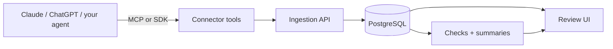

# Stepglass

**See every step. Understand every change.**

[](https://github.com/Aditya292248/stepGlass/actions/workflows/ci.yml)
[](LICENSE)

Stepglass is an open-source, self-hosted tool that records what an AI agent did, verifies what
actually changed in the systems it touched, and checks the result against your policies. A
reviewer who doesn't read code can open a run and answer four questions in under a minute: what
was the agent trying to do, what did it change, what went wrong, and which recorded step proves it.

> **Status: pre-alpha.** The repository is being built in public, one reviewable PR at a time.
> Nothing here is ready for production use yet.

## Why

Most agent traces show what the agent _said_ or what a tool _returned_. Neither proves the
business outcome. Stepglass records before/after evidence of every change and labels it honestly:

| Label        | Meaning                                                                                     |
| ------------ | ------------------------------------------------------------------------------------------- |
| **Verified** | Before/after snapshots confirm the change (in the same transaction, or by reading it back). |
| **Reported** | The tool said it succeeded, but there's no independent evidence.                            |
| **Unknown**  | Execution or verification was interrupted.                                                  |

Deterministic checks decide pass / fail / unknown. AI only explains the result, and every claim
links to a recorded step.

## How it fits together



## Repository layout

| Path          | Contents                                                                                       |
| ------------- | ---------------------------------------------------------------------------------------------- |
| `apps/`       | Deployable services: `api`, `worker`, `web`                                                    |
| `packages/`   | Domain-agnostic core libraries: `schema`, `checks`, `toolkit`, `rules`, `mcp-server`, `sdk-ts` |
| `connectors/` | Predefined tool packs with sandbox and live backends: `gmail`, `slack`, `stripe`               |
| `scenarios/`  | Demo scenarios built on connectors                                                             |
| `tooling/`    | Repository tooling, such as the layer-boundary check                                           |
| `docs/`       | Architecture notes and decision records                                                        |

The core never depends on a connector or scenario; `pnpm lint` enforces this.

## Development

Requirements: Node.js 24 (see `.nvmrc`), pnpm 10, Docker.

```bash
pnpm install
cp .env.example .env
docker compose up -d
pnpm lint && pnpm typecheck && pnpm test
```

See [CONTRIBUTING.md](CONTRIBUTING.md) for the full workflow.

## Contributing

Issues and pull requests are welcome. Please read [CONTRIBUTING.md](CONTRIBUTING.md) and the
[Code of Conduct](CODE_OF_CONDUCT.md). To report a vulnerability, follow [SECURITY.md](SECURITY.md).

## License

[Apache-2.0](LICENSE)
